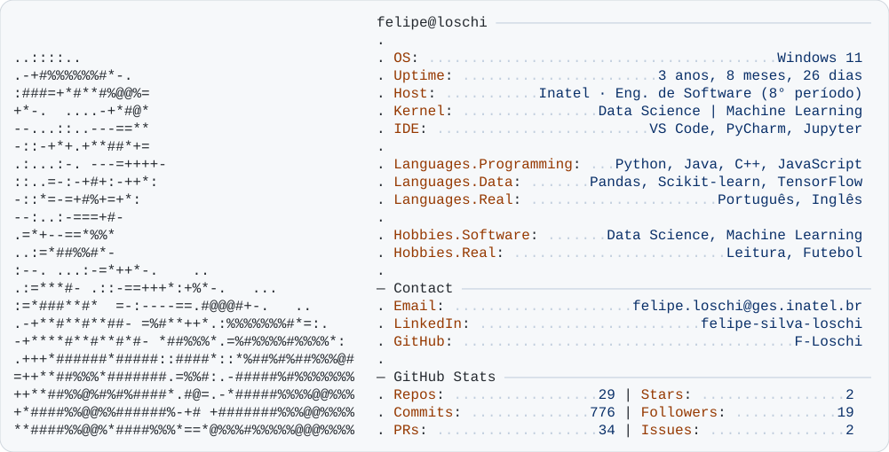
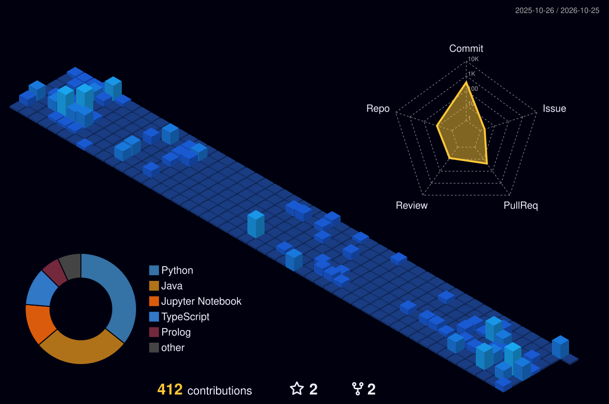

<picture>
  <source media="(prefers-color-scheme: dark)" srcset="assets/id_card_dark.svg">
  <source media="(prefers-color-scheme: light)" srcset="assets/id_card_light.svg">
  
</picture>

 

---

## Sobre mim

Monitor universitário de Cálculo, Probabilidade e Programação no Inatel. Ex-voluntário no **Cas@Viva**, onde ensinei C++ e Python para alunos do ensino público. Focado em construir uma base sólida em **Ciência de Dados** e **Machine Learning**, com objetivo de seguir para um mestrado após a graduação.

Atualmente aprofundando conhecimentos em ML com o curso [Python do básico ao Data Science](https://www.youtube.com/@teomewhy) do Téo Calvo.

> *Quando não estou codando, estou lendo ou acompanhando Real Madrid e Flamengo* ⚽📖

---

## Stack Técnica

  

  
  
  
  
  
  
  

---

## 📂 Projetos em Destaque

| Projeto | Descrição | Resultado | Stack |
| :--- | :--- | :---: | :--- |
| **[Titanic: Classificação de Sobreviventes](https://github.com/F-Loschi/Titanic)** | Competição do Kaggle com feature engineering, comparação de RF, XGBoost, SVM, Voting e Stacking e tuning via GridSearchCV. | Acurácia **0.77511** | `Python` `Scikit-learn` `XGBoost` |
| **[Previsão de Preços de Imóveis](https://github.com/F-Loschi/real-estate-mlp-predictor)** | MLP profunda (256→128→64→32) que une características físicas dos imóveis a indicadores socioeconômicos da região. | R² **0.85** | `Python` `TensorFlow` `Pandas` `Scikit-learn` |

---

## Experiência

- **Monitor** de Pré Cálculo, Cálculo 1, 2 e 3, Probabilidade e Processos Estocásticos, Paradigmas da Programação, Interação Homem-Máquina e Programação Orientada a Objetos — Inatel
- **Voluntário — Cas@Viva**: Ensino de C++, Python e Soft Skills para alunos do 9° ano da rede pública

---

## Certificações 🎓

- [Formação em Modelagem de Dados](https://cursos.alura.com.br/degree/certificate/33862e2d-7103-48c6-9f79-da1bfa0370cd?lang=pt_BR) — Alura
- [Python para Data Science](https://cursos.alura.com.br/degree/certificate/35c86fa9-ee76-4ee1-bf64-01d717efc4fa?lang=pt_BR) — Alura
- [Outros certificados](https://cursos.alura.com.br/user/f-s-loschi/fullCertificate/7cb0b08975869edd5a4d5798a567afef) — Alura

---

## 🏙️ Minha Cidade de Contribuições

  

---

<picture>
  <source media="(prefers-color-scheme: dark)" srcset="https://raw.githubusercontent.com/F-Loschi/F-Loschi/output/github-snake-dark.svg">
  <source media="(prefers-color-scheme: light)" srcset="https://raw.githubusercontent.com/F-Loschi/F-Loschi/output/github-snake.svg">
  
</picture>

